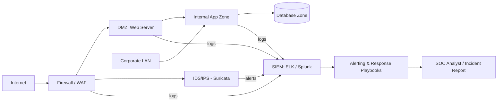

# Secure Enterprise Architecture & Workflow

Zones: Internet → DMZ → Application → Database, with default-deny firewall rules between zones, MFA for admin access and centralised logging.

## Incident response workflow
Detect (SIEM rule) → Triage (severity) → Contain (block IP/isolate host) → Eradicate → Recover → Lessons learned.
In this project: `siem/analyzer.py` (detect) → `siem/response.py` (contain, simulated) → `output/incidents/*.md` (reports).

## Risk assessment (sample)
| Asset | Threat | Likelihood | Impact | Risk | Control |
|---|---|---|---|---|---|
| SSH server | Brute force | High | High | High | Key auth, fail2ban, MFA |
| Web app | SQLi/XSS | Medium | High | High | WAF, secure coding, patching |
| Database | Data exfiltration | Low | Critical | Medium | Network segmentation, encryption |
| Logs | Tampering | Low | High | Medium | Central, write-once storage |

## Hardening checklist
- Disable root SSH login & password auth; enable fail2ban
- Patch OS/apps monthly; remove unused services
- Least-privilege accounts, MFA for admins
- Enable auditd/syslog forwarding; time sync (NTP)
- Encrypt data at rest and in transit (TLS 1.2+)
